# CDP&nbsp;Info query codes

The `C0` device-info codes ask a Cronto hardware token to display one of its own
attributes — the reader labels this command family **“CDP info”**. Each code
below is one **query**: it carries only a 1-byte selector naming the field to
show. The field *value* lives in the device’s on-screen response, not in the
code, so nothing personal is encoded here. All 13 selectors mapped by
fuzzing an owned device are reconstructed with the project encoder and verified
to round-trip with a valid CRC-24; the layout is cross-checked against a real
captured serial-query code.

> An interactive gallery version (codes embedded, no external files) is in
> [`cdp-info-codes.html`](cdp-info-codes.html). This page and it are produced by
> the same generator, `gen_cdp_info_page.py`.

## Payload structure

A 22-byte container behind a 1-byte length prefix. Only the selector changes
between codes; bytes 2–14 are not validated by the scanner (shown here as `11`
filler).

| offset | bytes | role |
|:--|:--|:--|
| *(prefix)* | `16` | length prefix (framing; = 22, the payload length) |
| 0 | `00` | discriminator — must be `00` |
| 1 | `c0` | command — device-info query |
| 2–6 | `11 11 11 11 11` | 5-byte field — **not validated** (arbitrary filler) |
| 7–14 | `11 11 11 11 11 11 11 11` | 8-byte field — **not validated** (nonce) |
| 15–18 | `08 01 01 01` | CDP-info parameter prefix |
| 19 | **`SEL`** | **query selector** — the byte that varies per code |
| 20–21 | `00 00` | terminator |

## Codes

| Selector | Field | Code | Payload |
|:--:|:--|:--:|:--|
| `01` | serial number | 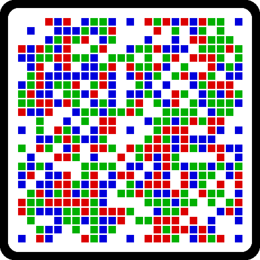 | `00c0 1111111111 1111111111111111 08010101` **`01`** `0000` |
| `02` | production date | 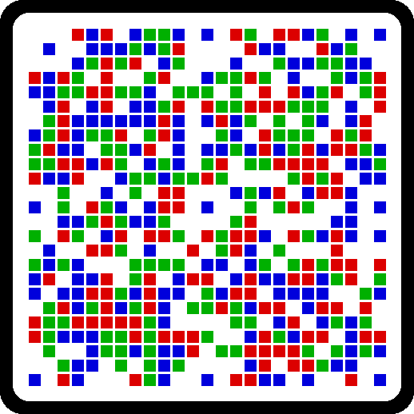 | `00c0 1111111111 1111111111111111 08010101` **`02`** `0000` |
| `04` | xtal correction ✻ | 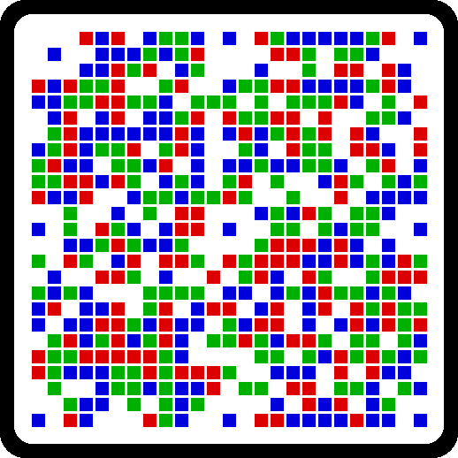 | `00c0 1111111111 1111111111111111 08010101` **`04`** `0000` |
| `05` | battery level | 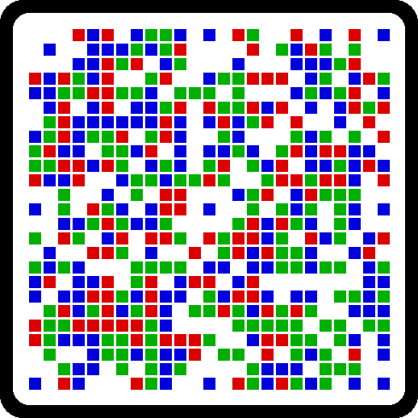 | `00c0 1111111111 1111111111111111 08010101` **`05`** `0000` |
| `06` | use count ✻ | 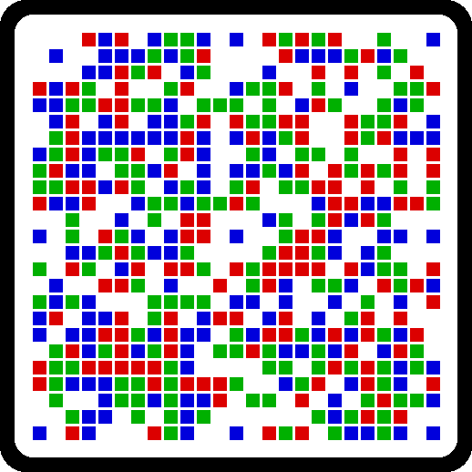 | `00c0 1111111111 1111111111111111 08010101` **`06`** `0000` |
| `07` | PIN error count | 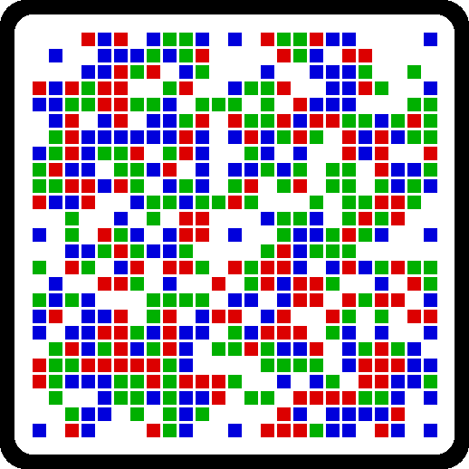 | `00c0 1111111111 1111111111111111 08010101` **`07`** `0000` |
| `08` | PIN status | 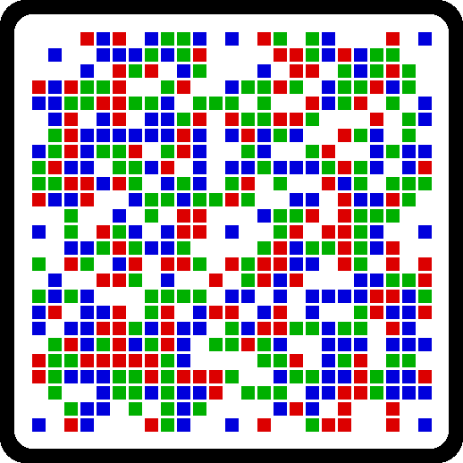 | `00c0 1111111111 1111111111111111 08010101` **`08`** `0000` |
| `09` | KCV (key check value) | 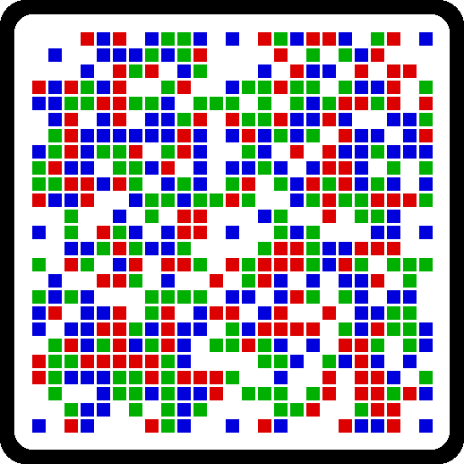 | `00c0 1111111111 1111111111111111 08010101` **`09`** `0000` |
| `0a` | platform ID | 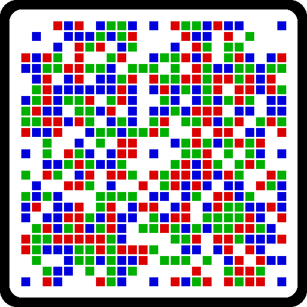 | `00c0 1111111111 1111111111111111 08010101` **`0a`** `0000` |
| `0b` | firmware version | 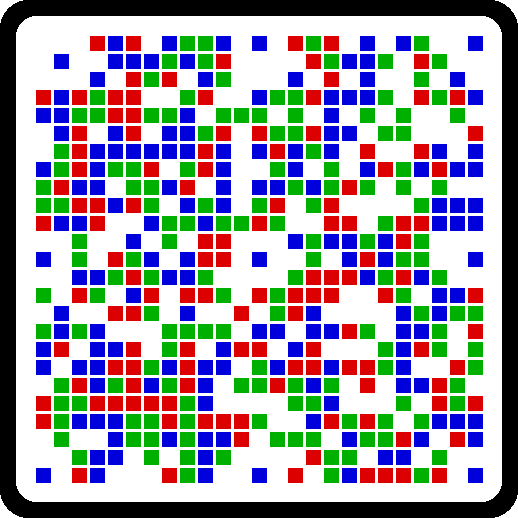 | `00c0 1111111111 1111111111111111 08010101` **`0b`** `0000` |
| `0c` | firmware checksum | 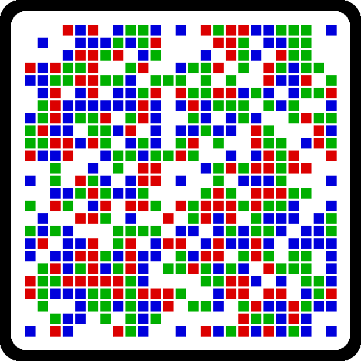 | `00c0 1111111111 1111111111111111 08010101` **`0c`** `0000` |
| `0d` | PIN OK count | 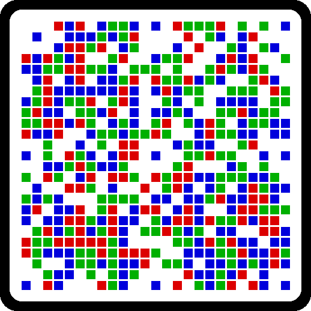 | `00c0 1111111111 1111111111111111 08010101` **`0d`** `0000` |
| `0e` | device ID | 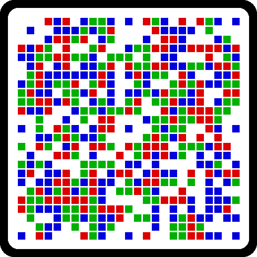 | `00c0 1111111111 1111111111111111 08010101` **`0e`** `0000` |

## Notes

- **Unsigned.** `C0` codes carry no per-message signature; the token acts on them
  without validating bytes 2–14.
- **Read-only.** These are diagnostic *reads* — a query code cannot change device
  state.
- **✻ unsupported.** Selectors `04` (xtal correction) and `06` (use count) return
  “unsupported” on the tested firmware.
- **KCV vs key.** Selector `09` returns the key check value — it verifies a
  candidate key against the device but does not reveal the key.

## Provenance

Selector map and container layout: `FORMAT.md §3.1` (ING Digipass scanner,
established by fuzzing an owned device). Images generated by `cronto/encoder.py`
at size 25 with length framing, and confirmed to decode back to each payload with
a valid CRC-24. Regenerate this page, the PNGs, and the HTML gallery with:

```bash
python3 docs/gen_cdp_info_page.py
```
